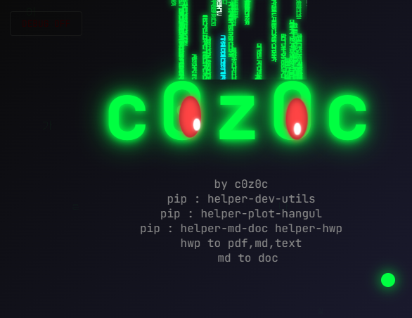
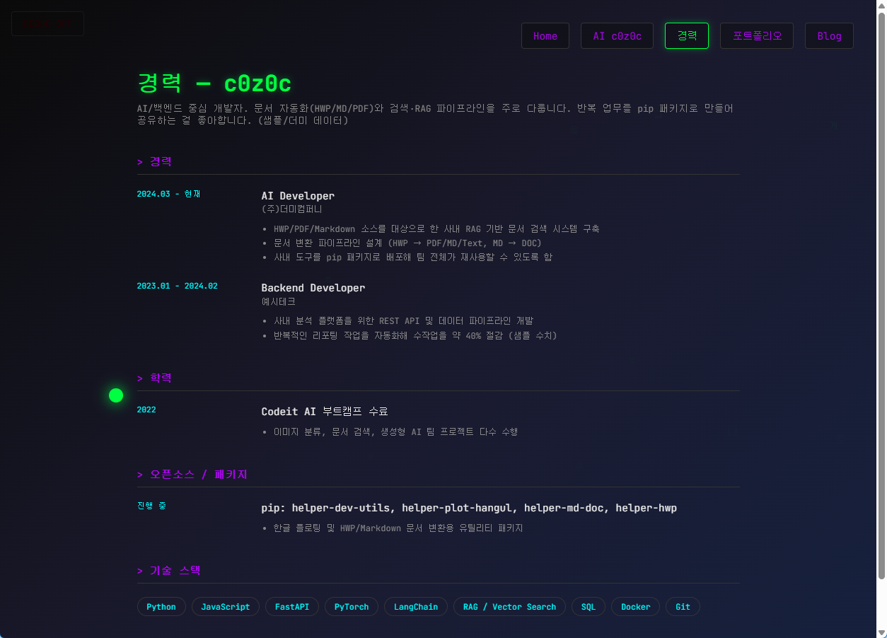
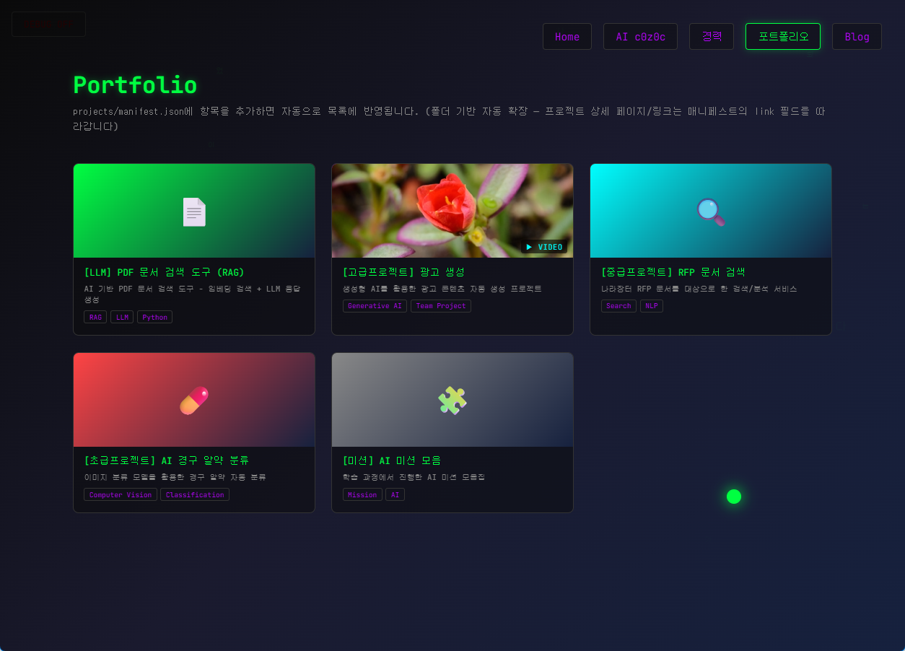
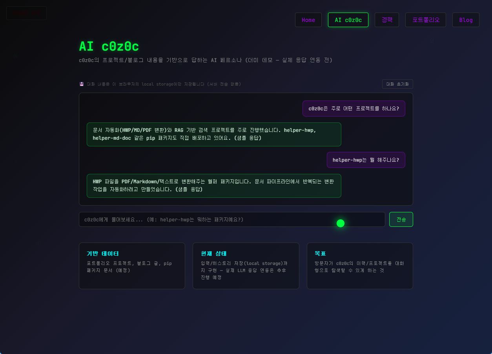
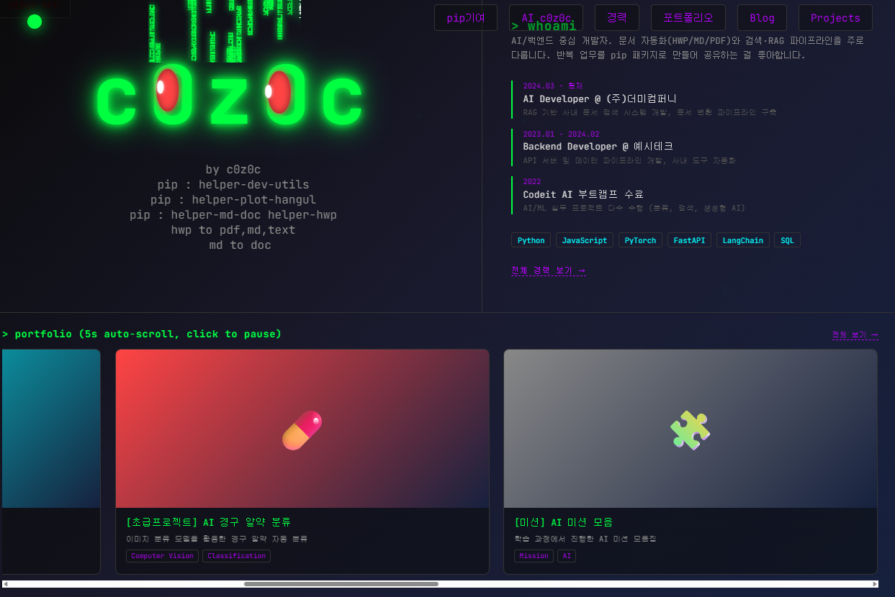

# GitHub 포트폴리오 기획서

- 작성자: c0z0c (c0z0c.dev@gmail.com)
- 사이트: https://c0z0c.github.io

---

## 1. 기획 의도 및 선정 사유

"이력서를 그대로 웹으로 옮긴 포트폴리오"가 아니라, **방문자가 3초 안에 시선을 뺏기고 끝까지 스크롤하게 만드는 포트폴리오**를 목표로 삼는다. 개발자 정체성(터미널/코드/AI)을 시각 언어로 옮기기 위해 "매트릭스 코드 폭포 + 해커 감성 다크 UI".

핵심 아이디어

1. **얼굴 = 아이디**: 로고를 텍스트 "c0z0c"로 만들고, 두 개의 `0`을 눈으로, 그 사이에서 흘러내리는 코드를 "머리카락"으로 연출해 별도 이미지 파일 없이 텍스트만으로 기억에 남는 비주얼.
2. **데이터와 화면의 분리**: 약력·프로젝트 내용은 JSON 파일에만 두고, HTML/JS는 그 JSON을 렌더링만 하도록 설계. 이력이 수정시 코드 수정없이 적용.
3. **나의 AI 페르소나**: GitHub Pages + AWS Lambda "나에 대해 물어보면 내 이력 기반으로 답하는 AI".

---

## 2. 화면 구성 시안 (캡쳐 기반)

### 2-1. 메인(Home) — `index.html`

- 좌상단: c0z0c 로고 얼굴 — 눈동자가 마우스를 따라 움직이고, 1~3초 간격으로 랜덤하게 깜빡이는 애니메이션 동작으로 동적 느낌을 활성화 하고 로고에 대한 독자의 주의력을 높인다.

- 로고 위로 매트릭스 스타일 텍스트가 끊임없이 흘러내리는 "머리카락"을 연출하여 생각하는 사람 혹은 인공지능의 느낌.

- 우상단: 경력 요약 패널 — `career.json` 데이터를 읽어 렌더링하고, "전체 경력 보기".

- 하단: 포트폴리오 스크롤 스트립 — `manifest.json` 데이터를 읽어 렌더링하고, 5초 자동 스크롤 및 스탑 기능 추가.

### 2-2. 경력(Career)

- 경력사항을 읽어 타임라인 형태로 배치 하고, 기술 스택 태그를 하단에 배치 합니다.

### 2-3. 포트폴리오(Portfolio)

- 프로젝트 추가 시 포트폴리오 카드가 자동으로 늘어나는 구조

- 카드별 원본 링크(Github/배포 URL)로 이동하도록 구성

### 2-4. AI c0z0c

- "나에 대해 질문하면 내 이력/프로젝트를 기반으로 답하는" 대화형 페이지
- 입력창 + 로컬스토리지 히스토리 저장/복원 + 초기화 버튼 + LLM 연동
- 나의 AI 페르소나로 약력 + 포트폴리오 기반 사실적 응답, 프롬프트 인젝션 방어

### 2-5. 화면 설계 초안

---

## 3. 요구 기능별 구현 계획

| # | 요구사항 | 구현 계획 |
|---|---|---|
| 1 | 메인 화면 애니메이션으로 시선 집중 | 눈동자 트래킹, 눈 깜빡임, 매트릭스 배경 |
| 2 | c0z0c 모양 로봇 + 매트릭스처럼 흘러내리는 글자 | 애니메이션 |
| 3 | 흘러내리는 글자에 숨은 의미 부여(찾아보는 재미) | 낙하 텍스트의 글자 풀(pool)은 김춘수 시 「꽃」("내가 그의 이름을 불러주기 전에는...") 전문을 글자 단위로 섞어 구성 — 방문자가 코드를 열어보거나 자세히 읽어야 알 수 있는 이스터에그 |
| 4 | 반응형 · 스마트폰 세로보기 지원 | 세로 및 가로 보기에 맞는 레이아웃 구성|
| 5 | JSON만 수정하면 약력/포트폴리오 반영 | 약력은 `assets/career.json` → `career.js`가 렌더링, 포트폴리오는 `projects/manifest.json` → `portfolio.js`가 렌더링하도록 분리. 소스코드 수정 없이 데이터 적용 |
| 6 | AIc0z0c: 나에 대한 질의응답 + 클라이언트 히스토리 저장 | 입력 UI, 응답 렌더링, `localStorage` 기반 대화 히스토리 저장/복원/초기화 기능을 갖추고, 실제 LLM 응답과 연동 |
| 7 | AI는 AWS에서 서비스, 인젝션 공격 시 블랙리스트 처리, JWT로 지속성 체크 | AWS Lambda(FastAPI) → Gemini / OpenAI(mini) 프록시 구조로 서비스. 인젝션 패턴 탐지 등, JWT 토큰으로 세션 지속성을 검증 |

---

## 4. 기술 스택

| 영역 | 사용 기술 |
|---|---|
| 프론트엔드 | HTML5, CSS3, Vanilla JS (프레임워크 미사용) |
| 배포 | GitHub Pages (디렉토리 기반 정적 배포) |
| 데이터 관리 | JSON 파일 기반 — 콘텐츠와 렌더링 로직 분리 |
| AI 백엔드 | AWS Lambda + FastAPI, Gemini / OpenAI(mini), JWT 인증, Rate limit/블랙리스트 |

